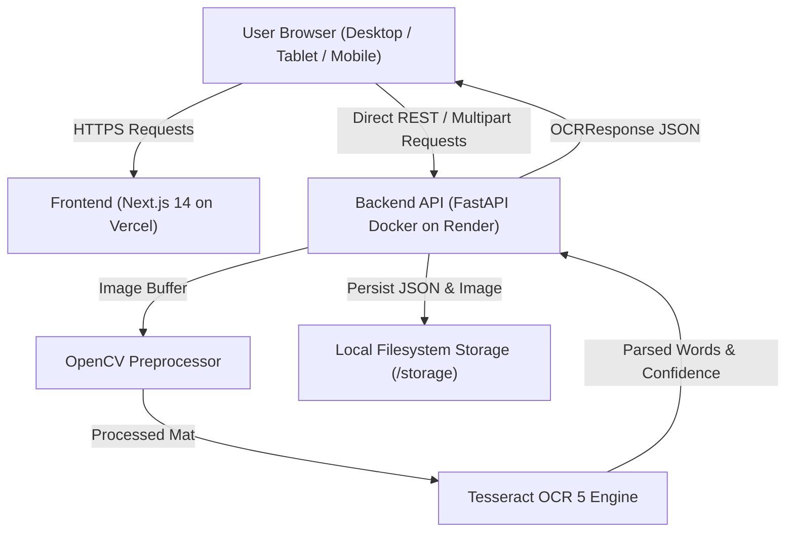

# System Architecture Documentation

QuickOCR is an end-to-end Optical Character Recognition application designed around speed, operational simplicity, and data privacy with a zero-database architecture.

---

## 🏗️ High-Level Overview

---

## 🧩 Architectural Components

### 1. Frontend Layer (Next.js 14)
- **App Router**: Uses modern React Server & Client component architecture.
- **State Management**:
  - **Redux Toolkit (RTK Query)** manages remote server state, caching, invalidation, polling, and cold-start timeouts.
  - **Scanner Slice** manages client UI state (selected language, upload file previews, and view modes).
- **Presentation & Styling**:
  - Tailwind CSS configured with a dark cyber-neon aesthetic.
  - Framer Motion for scroll reveal, interactive reticle HUD, and card entrance animations.
  - Responsive design supporting 320px mobile to 4K desktop viewports.
  - Reduced-motion accessibility fallback honoring `prefers-reduced-motion`.

### 2. Backend Layer (Python FastAPI)
- **FastAPI Core**: Lightweight ASGI framework running on Uvicorn.
- **Dynamic CORS Middleware**:
  - Restricts origins in production to designated frontend domains (`https://ocr-g3tg.vercel.app`).
  - Employs regex matching (`^https://.*\.vercel\.app$`) to support Vercel preview branch deployments seamlessly.
  - Supports comma-separated or JSON list environment variables without startup parse crashes.
- **OpenCV Image Processing**:
  - Grayscale conversion.
  - Fast non-local means denoising (`cv2.fastNlMeansDenoising`).
  - Dynamic scaling to normalize character stroke height.
  - Adaptive Gaussian thresholding (`cv2.adaptiveThreshold`) to overcome uneven lighting while preserving complex script marks (such as Khmer subscripts and accents).
- **Tesseract OCR 5 Ingestion**:
  - Page Segmentation Mode 6 (`--psm 6`) for uniform text blocks.
  - Word-level confidence extraction and bounding box coordinate aggregation into line-level details.
- **Filesystem Storage (Zero Database)**:
  - Uploaded images stored under `storage/uploads/{document_id}_{filename}`.
  - Extracted results stored as formatted JSON under `storage/results/{document_id}.json`.
  - Directory traversal prevention with filename sanitization.
